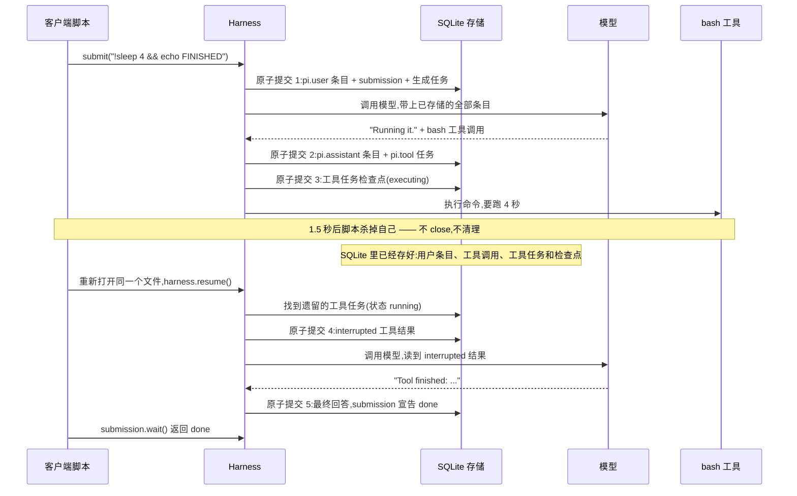

# pi-durable-hello

学习示例。五个小脚本,演示 `@earendil-works/pi-durable` 能做什么。
默认运行在免费的 faux 假模型上;要换真实模型,请在 `.env` 里设置 `PROVIDER=openrouter`。

- `npm run hello`   一问一答,存入 `.data/agent.sqlite`
- `npm run crash`   启动一个耗时 4 秒的 bash 工具,1.5 秒后杀掉进程
- `npm run resume`  重新打开数据库,把这次运行跑完
- `npm run twice`   把同一个 requestId 发送两次,得到同一个 submission
- `npm run watch`   在 steer 加入运行时,流式观察事件

## 时序图:一次运行如何度过崩溃

第 2、3 课(Node 版与 Python 版行为一致)发生的事情,按时间顺序。
每次"原子提交"都是一个事务 —— 无论进程死在哪一行,已落盘的数据都完整:

不要 push 到远端。用 `npm run clean` 删除 `.data/`,即可从头再来。
