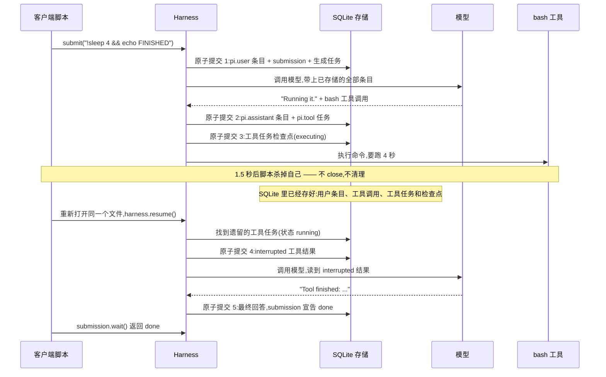

# pi-durable-hello 的 Python 版

Node 版(`../src/*.ts`)的 Python 移植。五个课程脚本效果一致,
底层是一个用**纯标准库**写的迷你 `pidurable` 包(约 500 行),
复刻了 `@earendil-works/pi-durable` 的核心语义。无任何第三方依赖。

## 运行

```bash
cd python/examples
python 01_hello.py     # 第 1 课:一问一答,存入 .data/agent.sqlite
python 01_hello.py     # 再跑一遍,第二次会打印第一次的条目
python 02_crash.py     # 第 2 课:进程在工具运行中途自杀(退出码 1 是预期的)
python 03_resume.py    # 第 3 课:重新打开数据库,同一次运行接着跑完
python 04_idempotent.py  # 第 4 课:同一个 requestId 发两次,得到同一个 submission
python 05_watch.py     # 第 5 课:流式观察事件,同时一个 steer 加入运行
python clean.py        # 删除 .data/,从头再来
```

默认使用免费的 faux 假模型(复读你的文本;`!` 开头则运行一次 bash)。
要换真实模型,在**仓库根目录**的 `.env`(与 Node 版共用)里设置:

```
PROVIDER=openrouter
OPENROUTER_API_KEY=sk-or-...
MODEL=anthropic/claude-sonnet-5.5
```

## 时序图:一次运行如何度过崩溃

第 2、3 课(Python 版与 Node 版行为一致)发生的事情,按时间顺序。
每次"原子提交"都是一个事务 —— 无论进程死在哪一行,已落盘的数据都完整:



## 目录结构

```
python/
  docs/
    storage-entities.md 一次存储涉及哪些实体:五张表、状态机与事务时间线详解
  pidurable/            迷你版库(对应 @earendil-works 的三个包)
    storage.py          SQLite 存储:条目/文档/任务/提交/事件,全部原子提交
    tools.py            工具注册表 + bash 工具 + 重放策略(replay policy)
    models.py           faux 假模型 + OpenRouter 真实模型
    harness.py          Harness / Conversation / Submission / watchEvents / 调度器
  examples/
    common.py           共享设置(对应 setup.ts)
    01_hello.py         ... 05_watch.py   五节课
    clean.py            清理 .data/
```

## TS → Python 对应关系

| TS 版 | Python 版 |
|---|---|
| `Harness.open(storage, ...)` | `Harness.open(db_file, models=..., registry=..., ...)` |
| `root.submit({type:"input", content}, ctx)` | `root.submit(content)` |
| `requestId` / `whenBusy: "steer"` | `request_id=` / `when_busy="steer"` |
| `submission.wait(ctx)` | `submission.wait()` |
| `harness.submission(id, ctx)` | `harness.submission(id)` |
| `harness.resume()` | `harness.resume()` |
| `watchEvents(harness, root.id, ctx)` | `watch_events(harness, root.id)` |
| `root.entries({}, 200, ...)` | `root.entries()` |
| `process.exit(1)` | `os._exit(1)` |

## 保留的核心语义

- **先提交,后展示**:每一步(用户条目、assistant 条目、工具结果、任务状态)
  都在一个 SQLite 事务里原子落盘,进程随时可死,数据不丢。
- **检查点**:每个任务(`pi.generation` / `pi.tool`)在每个阶段保存检查点;
  执行工具前先提交"executing"检查点,重启后据此分辨"没跑过"和"跑了一半"。
- **重放策略**:崩溃时正在执行、且不是 `replay="safe"` 的工具(如 bash)
  会得到一条 interrupted 结果:`Tool bash was interrupted and may have partially run`,
  由模型决定下一步 —— 持久的意思是**已保存检查点**,不是**恰好执行一次**。
- **requestId 幂等**:数据库唯一约束保证每个 requestId 只受理一次。
- **steer**:忙碌时到达的输入进收件箱,在当前工具轮次结束后并入对话。
- **pi.system 去重**:系统提示词和工具列表没变化就不重复存条目(保持提示词缓存命中)。
- **watch**:事件先落盘再被观察者读到;快照 + 增量流,UI 只是观察者。

## 与 Node 版的差异

- 只移植了 `bash` 一个工具(Node 版的 CodingTools 还含 read/write/edit)。
- faux 模型非流式回复(Node 版按 token 流式);OpenRouter 走非流式 chat/completions。
- 只实现了 root 一个会话(示例项目也只用 root)。
- Windows 上没有 bash 时,`sleep N` 会自动译成 `ping -n N+1 127.0.0.1` 等效等待。
- 迷你实现用于学习,未经生产检验;原版库锁定 1.0.3,仍是权威参考。
