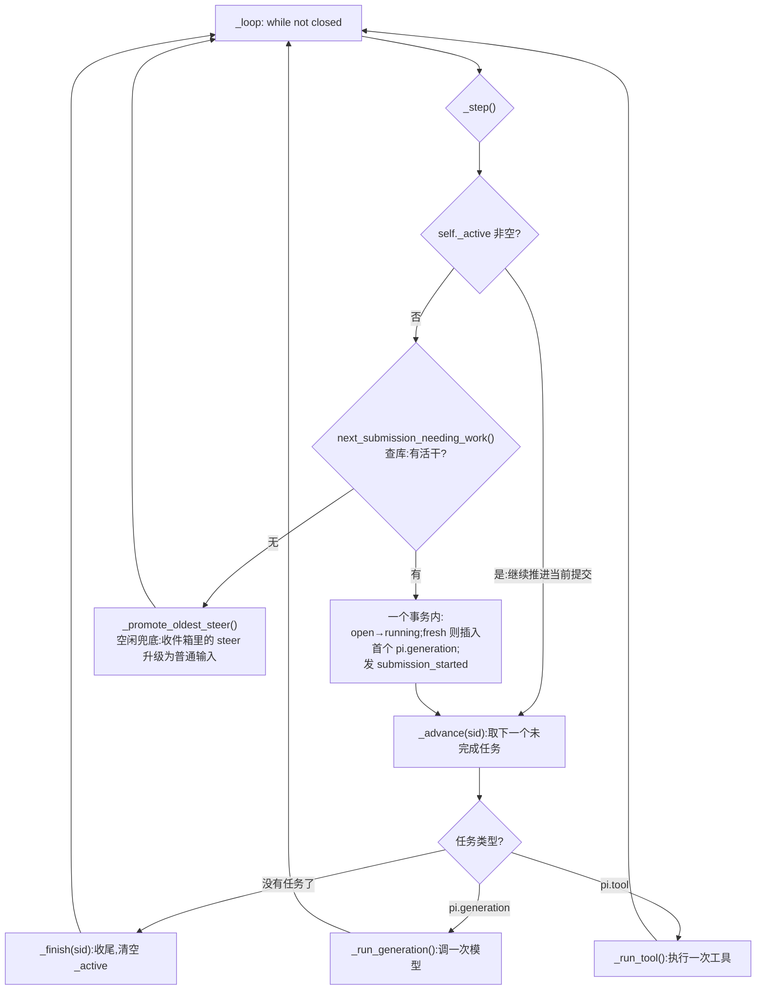
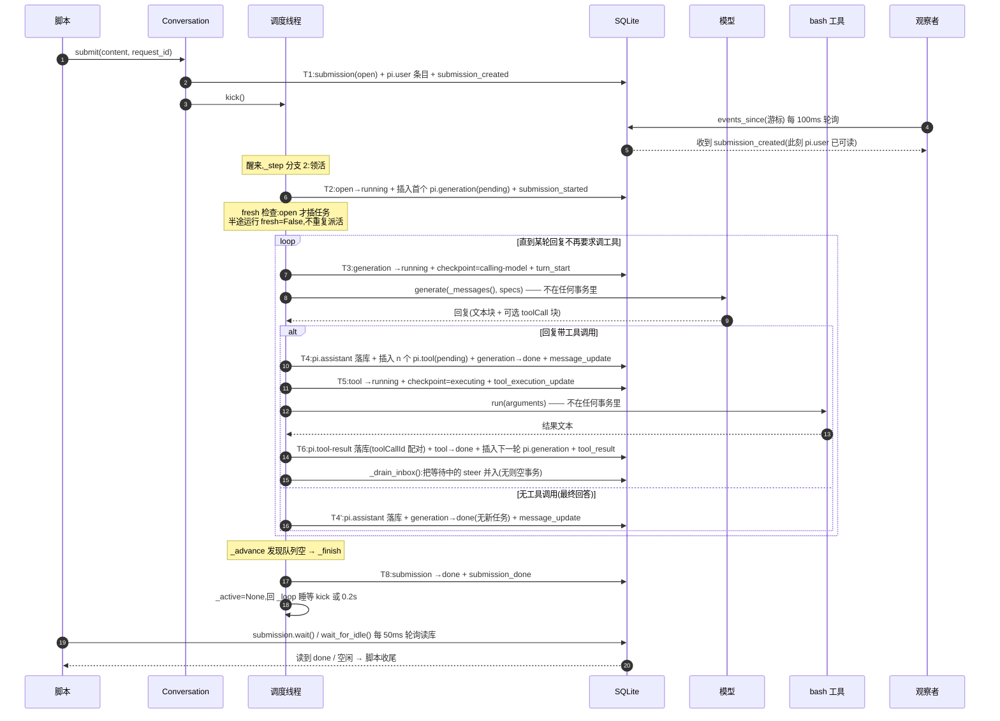
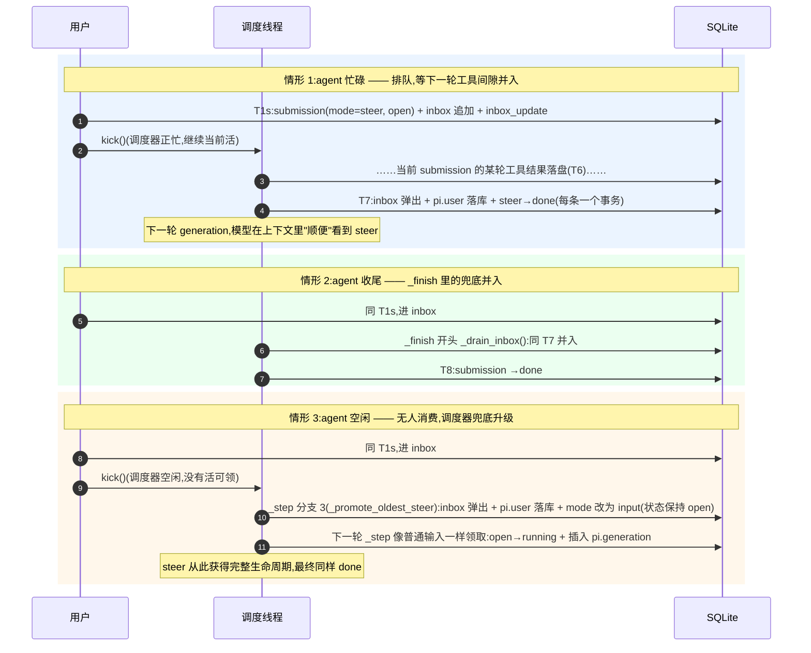

# 调度器(Harness Scheduler)详解

> 本文分析 `python/pidurable/harness.py` 里 `Harness` 的调度线程:`_loop` / `_step` / `_advance` 及两大执行器 `_run_generation` / `_run_tool`,回答一个问题:**这个调度器是怎么设计、怎么运转、崩溃后为什么总能接上?**
>
> 数据侧(五张实体表)见 [storage-entities.md](storage-entities.md) 与 [entities/](entities/entries.md);崩溃-续跑的完整时序图见 [python/README.md](../README.md)。

## 1. 定位:调度器是什么、不是什么

`Harness`(`harness.py:229`)是整个系统的心脏,由三部分组成:

- **storage**:SQLite 里的全部状态,唯一事实来源;
- **调度线程**:后台单线程 `pi-scheduler`,不断从库里挑待办任务来执行;
- **唤醒机制**:`threading.Condition` 充当"闹钟",`kick()` 立刻叫醒;没叫醒也有 0.2 秒轮询兜底。

调度器的**全部决策依据都在数据库里**:`next_submission_needing_work()` 挑活、`next_open_task()` 推进、`open_steers()` 兜底。内存里唯一的调度状态是 `self._active`(正在推进的 submission id)和 `_wake`/`_closed` 两个控制量 —— 它们都可以随时丢弃重建,这正是"进程可随时被杀"在调度侧的体现。

它**不是**的:不是多线程执行器(agent 工作天然串行,不做并行);不是事件循环(事件只是观察协议,见 [events.md](entities/events.md));不持有任何业务状态(一切以表为准)。

## 2. 三个核心设计决策

### 2.1 为什么单线程?

`harness.py:239-243` 的注释给出了理由:agent 的工作天然串行 —— 一个 submission 内的任务必须按序执行,多个 submission 也按 id 顺序公平排队。单线程让"同一时刻只有一处改动执行状态"成为不变量,再配合 `storage.commit()` 内部的 `RLock`,彻底避免竞态。

代价是吞吐:同一时刻只推进一个 submission、执行一个任务。对"耐久优先于并行"的教学实现来说,这是正确的取舍。

### 2.2 为什么"条件变量 + 轮询兜底"?

调度线程没事干时睡在 `_wake.wait(0.2)` 上(`harness.py:355-358`):

- **`kick()` 叫醒**:每次产生新工作(`submit()` 两条路径、`resume()`、`close()`)都调用,新工作能被立刻处理,不必等下一个轮询周期;
- **0.2 秒兜底**:即使某处忘了 kick,最多 0.2 秒后调度线程自己醒来看一眼库里有没有活。

同理,`wait_for_idle()` 以 50ms 轮询、`EventStream` 以 100ms 轮询(`harness.py:330`、`harness.py:191`)—— 演示代码全部用朴素轮询,换取直观和跨进程正确性(状态在库里,谁来查都一样)。

### 2.3 为什么调度线程是 daemon?

`harness.py:257-259`:主进程退出时调度线程跟着死,这没关系 —— 所有进度已落库,下个进程 `resume()` 就能接手。调度器自己也是"可丢弃的",这是整个体系纪律的一部分。

## 3. 主循环 `_loop`(`harness.py:334`)

```python
while not self._closed:
    try:
        worked = self._step()
    except Exception:
        traceback.print_exc()
        if self._active is not None:
            with self.storage.commit() as st:
                st.set_submission_status(self._active, "failed")
        self._active = None
        worked = False
    if not worked:
        with self._wake:
            if self._closed:
                return
            self._wake.wait(0.2)
```

三个要点:

1. **步进粒度 = 一次 `_step` 调用 = 至多一个任务**。`worked=True` 就立刻转下一轮,连着推进时实际是紧密循环;`worked=False` 才睡。
2. **异常不杀线程**:`_step` 抛错时,当前 submission 被原子提交为 `failed`(连"失败"也是落库状态,等待者轮询 `Submission.status` 能看到),调度器继续服务后续工作。
3. **异常分支的边界**:若异常发生在"领取"事务之前(`_active` 还是 None),没有 submission 可标记,下次循环重试;若发生在任务执行中,任务在库里的 status 停在 `pending` 或 `running`,与已失败的 submission 一起成为遗留痕迹(见第 10 节的已知简化)。

## 4. `_step`:每次调用三选一(`harness.py:360`)



### 4.1 分支 1:继续推进当前提交

`_active` 非空就直接 `_advance(sid)`,省掉一次查库。

### 4.2 分支 2:从库里领新的活

`next_submission_needing_work()`(`storage.py:154`)的查询条件是:

```
(open 且 mode='input')  或  (running 且存在未完成的任务)
```

前者是**刚排队的全新输入**;后者是**上个进程留下的半途运行** —— 一条查询同时服务"正常调度"和"崩溃恢复"。

领取本身是一个事务(`harness.py:373-383`):

- `fresh = (status == 'open')` —— 区分新输入与半途运行;
- open → running,占住这个提交;
- **仅 fresh 时**插入首个 `pi.generation` 任务。半途恢复(`fresh=False`)**不加新任务**:未完成的任务还在库里,`_advance` 从第一个未完成处继续 —— 这一步防止给恢复中的运行重复派活;
- 发 `submission_started` 事件。

### 4.3 分支 3:空闲兜底 `_promote_oldest_steer`

`harness.py:501`。steer 的语义是"运行途中插话",但如果递交 steer 时 agent 根本没在干活,它会一直躺在 `inbox` 文档里没人消费。所以调度器确认**真没事干**时,把收件箱里最早的一条 steer 弹出、写入 `pi.user` 条目、只把该 submission 的 `mode` 改成 `input`(status 保持 open)—— 下一轮 `_step` 就会像普通输入一样选中它。

注意 steer 的**正常**消费路径不在这里:运行途中由 `_run_tool()` 收尾后的 `_drain_inbox()` 并入,收尾时由 `_finish()` 兜底并入;本分支只处理"递交时就没人在干活"的孤儿 steer。

## 5. `_advance` 与任务流水线(`harness.py:386`)

`next_open_task(sid)` 取该 submission 按 id 最早的一个未完成任务:

- 没有 → `_finish(sid)`;
- `pi.generation` → `_run_generation(sid, task)`;
- `pi.tool` → `_run_tool(sid, task)`。

一次 input 的推进由此被切成一串任务,每个 `_step` 恰好执行一个:

```
pi.generation  →  pi.tool × n  →  pi.generation  →  ...  →  队列空,收尾
```

- generation 完成 → 回答里每个工具调用各生成一个 `pi.tool` 任务(先记账,后执行);
- tool 完成 → 结果落库,插一个新的 `pi.generation`,让模型带着结果继续;
- 直到某次回复不再要求调工具,队列清空,submission 宣告 done。

## 6. 两大执行器:"原子提交夹外部动作"的三明治结构

这是调度器崩溃安全的核心模式。**外部动作(调模型、跑 bash)不在任何事务里 —— 它们无法回滚;夹在它们前后的两次原子提交,才是恢复的全部依据。**

### 6.1 `_run_generation`(`harness.py:408`)

```
提交 1(事前检查点)   tasks: running + checkpoint={"phase":"calling-model"};events: turn_start
   ↓
models.generate(...)  ← 唯一的"外部世界"动作;死在这里,重启后任务仍是 running,重跑整个 generation
   ↓                     (调模型无副作用,重跑只多花算力;_ensure_system_entry 幂等)
提交 2(事后落盘)     entries: pi.assistant(model 列写模型引用);
                      tasks: 插 n 个 pi.tool(pending) + generation→done;
                      events: message_update
```

"回答落库 + 派生工具任务 + 任务完成"三件事同事务落盘 —— 不会出现"回复有了但任务没记上"的中间态。

### 6.2 `_run_tool`(`harness.py:434`)—— 崩溃恢复学问最大的一段

入口先看任务此刻的 `status`:

| 情况 | 判据 | 行为 |
|---|---|---|
| 没跑过 | `pending` | 走正常执行 |
| 跑了一半 | `running` 且工具 `replay != "safe"`(bash 就是;未知工具名同样处理) | **不重跑**,结果文本写为 `<harness> [error] Tool bash was interrupted and may have partially run </harness>`,把"到底执行了没有"的判断权交还模型 |
| 重复无害 | `running` 且工具 `replay == "safe"` | 直接重新执行 |

正常执行路径同样是三明治:

```
提交 1(事前检查点)   tasks: running + checkpoint={"phase":"executing"};events: tool_execution_update
   ↓
tool.run(arguments)   ← 死在这里就是第 2 课 02_crash.py 的场景(os._exit(1))
   ↓                     (工具抛异常不炸调度器:错误文本当作结果交给模型)
提交 2(收尾)         entries: pi.tool-result(带 toolCallId);
                      tasks: tool→done + 插入下一轮 pi.generation;
                      events: tool_result
   ↓
_drain_inbox()        ← 工具轮次结束,运行途中到达的 steer 此时并入
```

## 7. 收尾与 steer 的三个消费点

| 代码 | 时机 | 动作 |
|---|---|---|
| `_finish()`(`harness.py:398`) | 任务队列空 | 先 `_drain_inbox()` 兜底;事务:submission → done + `submission_done` 事件;清空 `_active` |
| `_drain_inbox()`(`harness.py:482`) | 每轮工具结束后、收尾前 | 循环到收件箱空;**每条 steer 单独一个事务**:弹出 inbox + 写 `pi.user` 条目 + 该 steer 的 submission 标记 done。运行途中陆续到达的 steer 一个不漏 |
| `_promote_oldest_steer()`(`harness.py:501`) | 调度器完全空闲 | 见第 4.3 节 |

空闲轮次里 `_drain_inbox()` 会开一个空事务、不写任何东西 —— 事务为空也安全,这是"一切经 commit()"纪律的统一代价。

## 8. 生命周期与外部接口

| 方法 | 行为 | 对调度器的影响 |
|---|---|---|
| `Harness.open(db_file, ...)`(`harness.py:263`) | 打开(或重开)SQLite 文件,构造 Harness 并启动调度线程 | 同一个文件就是同一个会话;open 本身不恢复,恢复靠 `resume()` |
| `resume()`(`harness.py:274`) | 事务内 `finalize_finished_submissions()`:running 但已无待办任务的 submission 直接补 done(工作与状态同事务落盘,"没活干"即"已做完");然后 `kick()` | 唤醒调度线程立刻接手遗留任务;这是**新进程接管旧现场**的入口 |
| `kick()`(`harness.py:293`) | `_wake.notify_all()` | 叫醒可能睡着的调度线程 |
| `wait_for_idle(timeout)`(`harness.py:309`) | 忙碌 = `_active` 非空 ∨ 有 open 的 input ∨ 有 open 的 steer ∨ `count_open_tasks_all() > 0`;50ms 轮询 | 四个条件全部来自实体表 + 一个内存量;它是课程脚本"等干完再退出"的依据 |
| `close()`(`harness.py:302`) | 置 `_closed` → kick → join(2s) → `storage.close()` | 优雅关停;不 kill 也不回滚 —— 已提交的数据本来就在库里 |

`_active` 为什么也要进 `wait_for_idle` 的判断?因为存在一个事务间隙:最终 generation 的收尾提交(T6 同款)已把任务全部置 done,而 `_finish` 的 done 提交还没落 —— 此刻"库里无未完成任务但 `_active` 非空"。进程若死在这个间隙,重启后由 `resume()` 的 finalize 补上 done;活着时由 `_active` 把这个窗口挡住。

## 9. 崩溃点逐个分析:每个位置死掉会发生什么

这是理解调度器设计的试金石。以第 2/3 课的输入(带 request_id,一次 bash 调用,事务编号对应 [storage-entities.md](storage-entities.md) 第 3 节 T1–T8)为例:

| 死亡位置 | 已提交的现场 | 重启 `resume()` 后 |
|---|---|---|
| T1 之前 | 无任何痕迹 | 仿佛输入从未递交 |
| T1(`submit`)之后 | submission open;`pi.user` 条目已落;request_id 已注册 | `next_submission_needing_work` 找到 open input,正常接手;重试同 request_id 也不会重复受理 |
| T2(领取)之后 | submission running;`pi.generation` pending | `fresh=False`,不重复派活;直接执行该任务 |
| T3(模型检查点)之后、模型调用中 | 任务 running + checkpoint=calling-model | generation **重跑**(无副作用);`_ensure_system_entry` 幂等,系统段不重复 |
| 模型返回后、T4 落盘前 | 同上 | 同上 —— 丢了的那次回复重跑一次即可 |
| T4(回复落盘)之后 | `pi.assistant` 已落;n 个 `pi.tool` pending | 从第一个 tool 继续;模型上下文由 entries 全量重放,与崩溃前一致 |
| T5(工具检查点)之后、bash 执行中 | 任务 running + checkpoint=executing | **interrupted 分支**:不重跑 bash,写入 interrupted 结果,模型自行决策 |
| bash 执行完、T6 落盘前 | 同上 | 同上(结果丢了就按"可能跑了一半"处理) |
| T6(结果落盘)之后 | `pi.tool-result` 已落;下一轮 generation pending | 继续生成,模型看到完整结果 |
| 最终 generation 完成、`_finish` 提交前 | submission running,但已无未完成任务 | `finalize_finished_submissions()` 补 done —— 无需重做任何工作 |
| `_finish` 之后 | 全部落库 | 无事可做 |

统一的不变量:**已提交的完整保留,未提交的仿佛从未发生;重启后从最后一个检查点继续,绝不从零重来。** 三条铁律(`harness.py:17-22`)逐一兑现:①每步先原子提交再展示(进程可丢弃);②每个阶段存检查点(可续跑);③requestId 只受理一次(重试无害)。

## 10. 已知简化与边界

迷你实现有意保留的口子,读源码时会碰到:

1. **failed 不发事件**:`_loop` 异常分支把 submission 置为 failed,但没有 emit —— 观察者只能靠轮询 `Submission.status` 发现失败。
2. **failed submission 的遗留任务不清理**:失败的 submission 不再被 `next_submission_needing_work` 选中(open/running 才会被选),它名下 pending/running 的任务就地留存;这是教学实现省掉的收尾工作。
3. **`_active` 是内存态**:进程死了它就没了,但它本来就只是加速判断的缓存 —— 真相永远在表里。
4. **无跨进程锁**:`storage.py` 只保证进程内串行(RLock + WAL);同一时刻一个库文件只归一个进程打开(示例脚本都是先杀旧进程再开新的)。两个进程同时 open 同一文件不在支持范围内。
5. **无优先级/并发调度**:submission 严格按 id 先来先服务,任务严格按 id 顺序执行;没有抢占、没有并行。
6. **轮询节奏是拍脑袋的演示值**:调度兜底 0.2s、idle 判断 50ms、事件流 100ms,统一"够用就好"。

## 11. 一图总结调度器的世界观

```
        ┌─────────── 内存(可丢弃)───────────┐
        │ _active  _wake  _closed  调度线程   │
        └───────────────┬───────────────────┘
                        │ 每步先 commit 再行动
        ┌───────────────▼───────────────────┐
        │  SQLite(唯一事实来源,五个实体表) │
        │  submissions:挑谁的活              │
        │  tasks:      干哪一步、到哪了      │
        │  entries:    说过什么(重放上下文) │
        │  documents:  inbox / system-state  │
        │  events:     给观察者看什么        │
        └───────────────────────────────────┘
```

调度器的全部行为可以浓缩成一句话:**每 0.2 秒(或被 kick 时)醒来一次,从库里挑一件活,走完"检查点提交 → 外部动作 → 收尾提交"的三明治,再挑下一件 —— 中途死了,下一个进程照着表接着来。**

## 附 A:完整时序图(调度线程视角)

### A1 主线:一次"生成 → 工具 → 生成"的完整运行

事务编号 T1–T8 对应 [storage-entities.md](storage-entities.md) 第 3 节(该节顶部附有这组事务的渲染时序图 `transaction-timeline.png`,可先看图再读下面的细粒度版本);两个灰色注记"不在任何事务里"的就是仅有的两处外部动作。崩溃分支(死在两个外部动作处会发生什么)见 [python/README.md](../README.md) 的崩溃-续跑时序图。



读图要点:

- **循环体 = 一次 generation 任务**(一个 `_step`)。回复里带工具调用时,T4 先把工具调用记成 `pi.tool` 任务,接下来的 `_step` 们依次执行 T5→bash→T6,再插回新的 generation,进入下一圈;
- **事件与状态同事务**:图上每个 T 里的事件(如 T5 的 `tool_execution_update`)和检查点一起 COMMIT,所以观察者收到事件时,对应事实必已可读;
- **脚本的 wait/轮询只读库**:等待者与调度器之间没有任何直接通信,通信介质就是 SQLite 本身。

### A2 支线:steer 的三种归宿

steer(`submit(when_busy="steer")`)不进入任务流水线,它只有一份拷贝在 `documents.inbox` 里,三种时机被消费:



三条路径殊途同归:steer 的内容最终都会变成一条 `pi.user` 条目、它的 submission 都会到达 done —— 区别只在于是"并入现有对话"还是"升级为新输入"。

## 附 B:`_run_tool` 逐行注释(`harness.py:434-480`)

这是整个调度器里崩溃恢复学问最大的一段,逐行拆开。代码摘录(去掉原 docstring),每行右侧的圆圈编号对应下方的注释:

```python
def _run_tool(self, sid: int, task: Dict[str, Any]) -> None:
    call = task["payload"].get("toolCall", {})                              # ②
    name = call.get("name", "")                                             # ②
    tool = self.registry.get(name)                                          # ③
    tool_call_id = call.get("id")                                           # ④

    if task["status"] == "running" and (tool is None or tool.replay != "safe"):
        # ⑤ 崩溃恢复判定:interrupted 分支
        result_text = "<harness> [error] Tool {} was interrupted and may have partially run </harness>".format(name)
    else:
        # ⑥ 正常执行
        with self.storage.commit() as st:
            # ⑦ 事前检查点
            st.update_task(task["id"], status="running", checkpoint={"phase": "executing"})
            st.emit("tool_execution_update", {"submissionId": sid, "tool": name})
        try:
            if tool is None:
                result_text = "[unknown tool {}]".format(name)              # ⑧
            else:
                result_text = tool.run(call.get("arguments", {}))           # ⑨ 外部动作
        except Exception as exc:
            result_text = "[error] {}".format(exc)                          # ⑩

    with self.storage.commit() as st:
        # ⑪ 收尾提交(两条分支共用)
        st.append_entry(
            "pi.tool-result",
            [{"type": "text", "text": result_text, "toolCallId": tool_call_id}],
        )
        st.update_task(task["id"], status="done")
        st.insert_task("pi.generation", sid, {"submissionId": sid})         # ⑫
        st.emit("tool_result", {"submissionId": sid, "tool": name})

    self._drain_inbox()                                                     # ⑬
```

| # | 逐行解释 |
|---|---|
| ① | `sid` 是挂靠的 submission id(只用于发事件);`task` 是 `_advance` 从 `next_open_task()` 取回的完整任务行。此刻 `task["status"]` 只可能是 `pending` 或 `running` —— done 的已被查询过滤 |
| ② | 从 payload 拆出工具调用三要素。payload 是 T4 事务里从 assistant 条目的 `toolCall` 块**原样拷贝**的,所以这里的 name/arguments/id 与模型看到的一致 |
| ③ | 从工具注册表找实现;名字不存在时返回 `None`。注意 `tool` 可能是 None,后续所有分支都要能处理这种情况 |
| ④ | `toolCallId`:收尾提交时写进 tool-result 条目,与 assistant 条目里的调用块**配对** —— 模型下一轮就靠这组 id 对上"我的调用"和"它的结果" |
| ⑤ | **恢复逻辑的全部判据**。前半个条件:`status == "running"` 只可能来自上个进程 —— 活着的进程会把任务一口气从 pending 推到 done,绝不会带着 running 状态回到调度器(第 4 节讲过 status 只进不退)。后半个条件:工具不可重放(有副作用)才走 interrupted,**未知工具名按最保守处理**。生成的提示文本本身是一条合法的 tool-result:模型读得懂,由它决定重试、绕开还是询问用户 |
| ⑥ | `pending`(从没跑过)或 `replay == "safe"`(重放无害,如读文件)→ 照常执行 |
| ⑦ | **崩溃安全的关键一笔**:先提交"正要执行"这个事实,再动手。此后进程任何时刻死掉,重启后任务都是 running,⑤ 据此分辨"没跑过"和"跑了一半"。事件与检查点同事务:观察者收到 `tool_execution_update` 时,检查点必已落盘 |
| ⑧ | 工具不存在也不抛错 —— 照样给模型一个可读的结果,让它自行处置 |
| ⑨ | 全函数唯一的"外部世界"动作,bash 跑多久都可能。死在这一行 = 第 2 课 `02_crash.py` 的场景 |
| ⑩ | 工具异常不炸调度器:异常文本当作结果交给模型 —— 错误也是"结果",模型自治 |
| ⑪ | **无论走⑤还是⑥,收尾都走同一事务**:结果落库 + 任务置 done + 派生下一轮 + 发事件,四笔原子提交。interrupted 分支也照常 —— 这保证流水线不被堵死(如果 interrupted 后不置 done、不插任务,submission 会永远卡住) |
| ⑫ | 插入下一轮 `pi.generation` 是**流水线的动力**:模型读到结果后继续作答;直到某轮回复不再要求调工具,那次 generation 的收尾提交就不会再插任务,队列自然清空,`_finish` 接手 |
| ⑬ | 工具轮次结束是并入 steer 的安全点(附 A2 情形 1):模型下一轮重放上下文时自然看到并入的内容 |

一句话总结这段代码的纪律:**先记账(⑦)、再干活(⑨)、后收账(⑪);记账和收账之间死掉不可怕,重启后⑤靠着库里的 status 分辨一切。**

---

### 相关文件

- `python/pidurable/harness.py` —— 本文全部分析对象;文件头注释有同样的铁律与流水线说明
- `python/pidurable/storage.py` —— 调度器的全部决策查询(`next_submission_needing_work` 等)
- [storage-entities.md](storage-entities.md) —— T1–T8 事务时间线(本文多处引用)
- [entities/tasks.md](entities/tasks.md) / [entities/submissions.md](entities/submissions.md) —— 被调度的两类实体
- [entities/events.md](entities/events.md) / [entities/documents.md](entities/documents.md) —— steer 收件箱与观察协议
- `python/examples/02_crash.py` / `03_resume.py` —— 崩溃与续跑的活体演示
