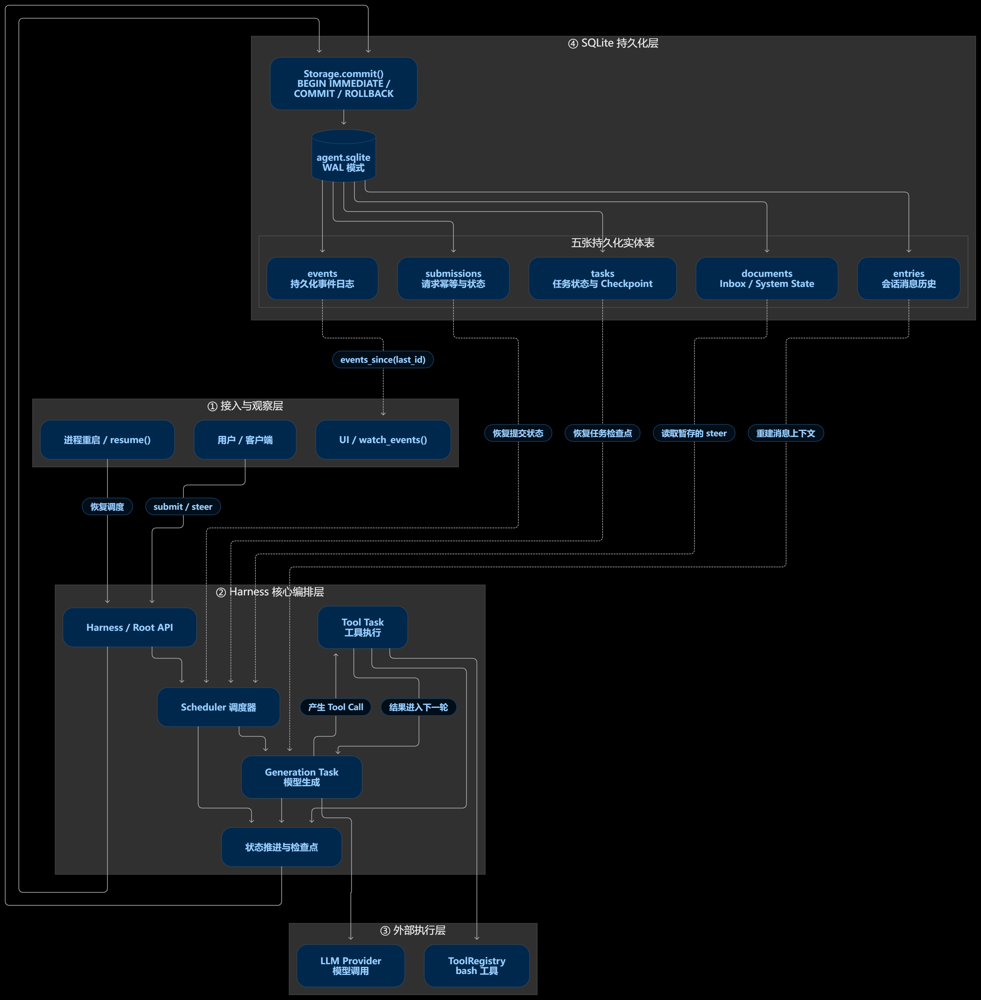
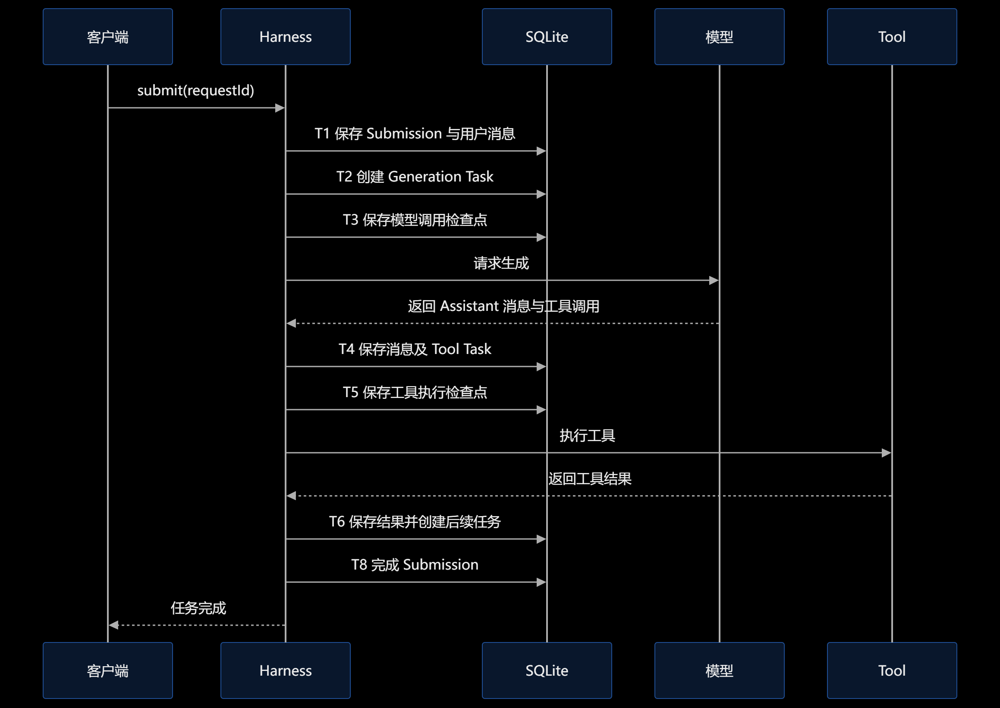

# 一次存储涉及哪些实体 —— Python 版持久化详解

本文对应 `python/pidurable/` 迷你库(当前代码共 1133 行:`harness.py` 564、`storage.py` 244、`tools.py` 106、`models.py` 192、`__init__.py` 27),回答一个问题:
**python 版的一次"存储"到底碰了哪些实体信息?**

先说结论:

- **一次存储 = 一个 SQLite 事务**(`Storage.commit()`)。with 块里的所有写入要么全部落盘,要么什么都不落。
- **载体 = 一个文件**:`python/.data/agent.sqlite`(外加 SQLite WAL 的 `-wal` / `-shm` 伴生文件)。
- **实体 = 五张表**:`entries`(条目)、`documents`(文档)、`submissions`(提交)、`tasks`(任务)、`events`(事件)。
  所有状态都在里面;进程死了,下次打开同一个文件,会话原样还在。



上面这张图从**分层视角**看同一次存储:①接入与观察层(`resume()` / 用户 `submit` / `watch_events`)通过 ②Harness 编排层(Scheduler、Generation/Tool 任务、检查点)落到 ④SQLite 持久层 —— 所有业务写入都经 `Storage.commit()` 进入 `agent.sqlite`,再分发给五张实体表;而 ③外部执行层(模型调用、bash 工具)**不在任何事务里**,崩溃恢复的信息全部来自持久层的表。下面的 ER 图则聚焦实体本身的字段与关系:

```mermaid
erDiagram
    submissions ||--o{ tasks : "submission_id 挂靠"
    submissions ||--o{ submissions : "request_id 幂等去重"
    documents {
        TEXT key PK "inbox | pi.system-state"
        TEXT value "JSON"
    }
    entries {
        INTEGER id PK "自增,顺序即时间线"
        TEXT kind "pi.user | pi.assistant | pi.tool-result | pi.system"
        TEXT content "JSON: 字符串或块列表"
        TEXT model "JSON 模型引用,仅 pi.assistant 有"
    }
    tasks {
        INTEGER id PK
        TEXT type "pi.generation | pi.tool"
        TEXT status "pending | running | done"
        INTEGER submission_id FK
        TEXT payload "JSON"
        TEXT checkpoint "JSON: calling-model | executing"
    }
    submissions {
        INTEGER id PK
        TEXT request_id UNIQUE "幂等键"
        TEXT mode "input | steer"
        TEXT status "open | running | done | failed"
        TEXT created_at "datetime"
    }
    events {
        INTEGER id PK
        TEXT type "submission_created 等 8 种"
        TEXT payload "JSON"
    }
```

> 说明:ER 图里的 `submissions ||--o{ tasks` 只表达**逻辑挂靠**。实际 `SCHEMA` 中 `tasks.submission_id` 是普通 `INTEGER NOT NULL` 列,没有声明 `FOREIGN KEY` 约束(代码依据):
>
> ```sql
> -- storage.py:38-45
> CREATE TABLE IF NOT EXISTS tasks (
>   id            INTEGER PRIMARY KEY AUTOINCREMENT,
>   type          TEXT NOT NULL,
>   status        TEXT NOT NULL,
>   submission_id INTEGER NOT NULL,
>   payload       TEXT NOT NULL,
>   checkpoint    TEXT
> );
> ```

---

## 1. 什么算"一次存储"

`python/pidurable/storage.py` 里的 `commit()` 是唯一写入口:

```python
with storage.commit() as st:
    st.append_entry("pi.user", content)   # ← with 块里的每一笔写入
    st.insert_submission("input", req_id) #   都在同一个事务里
    st.emit("submission_created", {...})
# 离开 with:全部 COMMIT;块里抛异常:全部 ROLLBACK
```

三条存储铁律(与 TS 原版一致,写在 `harness.py` 文件头):

1. **每一步先原子提交,再展示给任何人** —— 进程因此是可丢弃的。
2. **每个任务在每个阶段保存检查点** —— 重启后从最后一个检查点继续。
3. **每个 `requestId` 只受理一次** —— 受理前先 `find_submission_id_by_request()` 查重(`harness.py:126-130`、`harness.py:143-147`);`submissions.request_id` 的 UNIQUE 约束(`storage.py:33`)是兜底。

### 存储层怎么保证原子性

| 机制 | 代码 | 作用 |
|---|---|---|
| 显式事务 | `isolation_level=None` + `BEGIN IMMEDIATE` / `COMMIT` / `ROLLBACK` | 一次 commit = 一个原子事务 |
| WAL 日志 | `PRAGMA journal_mode=WAL` | 写不阻塞读;崩溃后由 SQLite 自身恢复 |
| 进程内串行 | `threading.RLock` | 本实现的多个线程共享连接,提交线串行化 |
| 忙等待上限 | `PRAGMA busy_timeout=5000` | 遇到锁短暂等待,5 秒后报错 |

> 注意:没有**跨进程**锁。一个数据库文件同一时刻只归一个进程打开(示例脚本都是先杀旧进程再开新的)。

### 物理文件

```
python/.data/
  agent.sqlite        ← 主文件,五张表都在这里
  agent.sqlite-wal    ← 预写日志(打开后由 SQLite 管理)
  agent.sqlite-shm    ← WAL 的共享内存索引
  last-submission.json ← 第 2 课写的普通 JSON,不属于存储实体,只为 03_resume 找回 submission id
```

`02_crash.py` 用 `os._exit(1)` 杀进程,不 `close()`、不清理 —— `-wal` 里的已提交数据由 SQLite 恢复,这就是"可丢弃进程"的底气。

---

## 2. 五张实体表逐个详解

全部建表语句在 `storage.py` 的 `SCHEMA` 字符串里。下面按"存什么、什么时候写、被谁读"逐个过。

### 2.1 `entries` —— 发言记录(会话的正文)

会话 transcript 的本体。`ORDER BY id` 就是时间线;`root.entries()` 读的就是它。

| 列 | 类型 | 含义 |
|---|---|---|
| `id` | INTEGER PK AUTOINCREMENT | 全局单调,恢复与展示都按它排序 |
| `kind` | TEXT NOT NULL | 条目种类,见下表 |
| `content` | TEXT NOT NULL | JSON:纯字符串,或块(block)列表 |
| `model` | TEXT(可空) | JSON 模型引用 `{"provider": ..., "modelId": ...}`,**只有 `pi.assistant` 会写** |

`kind` 的四种取值:

| kind | 谁写入 | content 长什么样 |
|---|---|---|
| `pi.user` | `submit()`、`_drain_inbox()`、`_promote_oldest_steer()` | 用户输入的原文(字符串或块) |
| `pi.assistant` | `_run_generation()` 第二段 | `Reply.blocks()`:文本块 + 0..n 个 `toolCall` 块(块里带 `name` / `arguments` / `id`) |
| `pi.tool-result` | `_run_tool()` 第二段 | `[{"type": "text", "text": 结果文本, "toolCallId": 调用 id}]`;崩溃恢复时写的是 `interrupted` 提示文本 |
| `pi.system` | `_ensure_system_entry()` | **恒为空字符串 `""`**。系统提示词本体不在这里,在 `documents` 的 `pi.system-state` 里;这条空条目只负责"对话历史中此处有一条系统段"的占位 |

组装模型消息时(`harness._messages()`),只有 `pi.user` / `pi.assistant` / `pi.tool-result` 三种会进消息列表;`pi.system` 被跳过。

**注意:当前 Python 实现没有把 `pi.system-state` 里的提示词拼进模型请求。** `_ensure_system_entry()` 的 docstring 写得很明确:"本迷你版只把系统提示词记录在案,并未拼进真正的模型请求(假模型用不上;真实模型层也未使用它 —— 见 models.py)"。`_messages()` 也不构造 system 消息,所以模型实际收到的只有下面三种角色:

```python
# harness.py:542-564(节选)
for entry in self.storage.list_entries():
    kind = entry["kind"]
    if kind == "pi.user":
        msgs.append({"role": "user", "content": entry["content"]})
    elif kind == "pi.assistant":
        msgs.append({"role": "assistant", "content": entry["content"]})
    elif kind == "pi.tool-result":
        msgs.append({"role": "toolResult", "content": entry["content"]})
    # pi.system 不进消息列表:系统提示词由 pi.system-state 文档维护
```

(最后一行是源码里的原注释,指的是"去重基准"存放在文档里;它不表示文档内容被发送给了模型。)

### 2.2 `documents` —— 少量键值状态

| 列 | 类型 | 含义 |
|---|---|---|
| `key` | TEXT PK | 文档名 |
| `value` | TEXT NOT NULL | JSON 值 |

本实现真实用到的只有两个 key:

| key | 值的结构 | 谁写 / 谁读 |
|---|---|---|
| `inbox` | `[{"submissionId": 3, "content": ...}, ...]` | `submit(when_busy="steer")` 追加;`_drain_inbox()` / `_promote_oldest_steer()` 弹出。steer(忙碌时引导)的暂存收件箱 |
| `pi.system-state` | `{"system": SYSTEM_PROMPT, "tools": ["bash"]}` | `_ensure_system_entry()` 写;用它做**去重**:状态没变就不追加新的 `pi.system` 条目。注意本迷你版只记录状态,不把提示词注入模型请求(见下) |

`_ensure_system_entry()` 的真实行为(代码依据):

```python
# harness.py:533-540(函数体;函数定义见 harness.py:523)
state = {"system": SYSTEM_PROMPT, "tools": self.registry.names()}
if self.storage.get_doc("pi.system-state") == state:
    return
with self.storage.commit() as st:
    if st.get_doc("pi.system-state") == state:  # 事务内复查,防止并发重复写
        return
    st.append_entry("pi.system", "")  # 条目做记录;具体内容由 state 文档承载
    st.set_doc("pi.system-state", state)
```

它的 docstring 同时说明:"本迷你版只把系统提示词记录在案,并未拼进真正的模型请求(假模型用不上;真实模型层也未使用它 —— 见 models.py)"。所以"保持提供商提示词缓存命中"是这套结构**想表达的语义**,当前 Python 实现并不会真的发送 system 消息,也就谈不上实际命中。

### 2.3 `submissions` —— 一次输入的受理记录

用户每递交一次输入(`submit()`),产生一行。调度器所有判断都围绕它。

| 列 | 类型 | 含义 |
|---|---|---|
| `id` | INTEGER PK AUTOINCREMENT | 句柄 `Submission.id`,跨进程也能用 `harness.submission(id)` 重新取得 |
| `request_id` | TEXT UNIQUE(可空) | **幂等键**。客户端带 `request_id` 重试时,`find_submission_id_by_request()` 找到旧行直接返回,不重复受理 |
| `mode` | TEXT DEFAULT 'input' | `input` = 普通输入;`steer` = 忙碌时引导 |
| `status` | TEXT NOT NULL | 状态机,见下 |
| `created_at` | TEXT DEFAULT datetime('now') | 受理时刻 |

`status` 状态机:

```
        submit()                调度器领取          正常完成
  open ──────────────────► running ───────────────► done
    │                        │
    │ steer 被并入对话        │ _loop 捕获异常
    ▼                        ▼
   done                    failed
```

- steer 类 submission 的生命周期很短:进 `inbox` 文档等待;被 `_drain_inbox()` 并入对话时直接 `open → done`;若当时系统空闲,由 `_promote_oldest_steer()` 改 `mode` 为 `input`,按普通输入重新走一遍。
- 状态更新点:`_step()`(open→running)、`_finish()`(→done)、`_loop()` 异常分支(→failed)、`finalize_finished_submissions()`(resume 时把"running 但已无待办任务"的行收尾为 done)。

### 2.4 `tasks` —— 工作单元 + 崩溃检查点

真正"干活"的单位。一次运行的推进被切成一串任务,每个任务的状态变化本身就是崩溃恢复的依据。

| 列 | 类型 | 含义 |
|---|---|---|
| `id` | INTEGER PK AUTOINCREMENT | |
| `type` | TEXT NOT NULL | `pi.generation`(调模型)或 `pi.tool`(执行工具) |
| `status` | TEXT NOT NULL | `pending → running → done`;**只进不退**,重启后读到 `running` 通常就是"上一个进程死在半路"。任务执行抛异常时 submission 会被 `_loop` 置 `failed`,其任务可能留在 `running`/`pending`,但不会再被调度(见 [scheduler.md](scheduler.md) 第 3、10 节) |
| `submission_id` | INTEGER NOT NULL | 挂靠的 submission |
| `payload` | TEXT NOT NULL | JSON:`pi.generation` 是 `{"submissionId": n}`;`pi.tool` 是 `{"toolCall": {"name": ..., "arguments": ..., "id": ...}}` |
| `checkpoint` | TEXT(可空) | JSON 阶段检查点:`{"phase": "calling-model"}`(调模型前)或 `{"phase": "executing"}`(执行工具前) |

检查点是崩溃安全的关键一笔。`_run_tool()` 在真正执行工具**之前**先提交:

```python
# harness.py:457-466
with self.storage.commit() as st:
    st.update_task(task["id"], status="running", checkpoint={"phase": "executing"})
    st.emit("tool_execution_update", {"submissionId": sid, "tool": name})
# ↑ 这笔提交落盘后才开始跑工具
#   若进程死在这里,重启后任务仍是 running → 走 interrupted 分支
try:
    if tool is None:
        result_text = "[unknown tool {}]".format(name)
    else:
        result_text = tool.run(call.get("arguments", {}))
except Exception as exc:
    result_text = "[error] {}".format(exc)
```

恢复逻辑(`_run_tool()` 开头)据此分辨两种情况:

| 重启时读到的状态 | 结论 | 处理 |
|---|---|---|
| `status == "pending"` | 工具**没跑过** | 照常执行 |
| `status == "running"` 且工具 `replay != "safe"`(bash 就是这样) | 工具**可能跑了一半** | 不重跑;写入 `interrupted` 结果 `<harness> [error] Tool bash was interrupted and may have partially run </harness>`,让模型自己决定下一步 |
| `status == "running"` 且工具 `replay == "safe"` | 重复执行无害 | 直接重新执行 |

> 迷你库里唯一的工具 `bash` 是 `replay="interrupted"`。`replay="safe"` 的语义(如读文件)在 `tools.py` 的注释里有说明,但示例未安装这类工具。

### 2.5 `events` —— 观察者事件流(供 watch 使用)

给第 5 课的 `watch_events()` 消费。事件**先落盘,再被观察者读到** —— UI 只是已提交状态的观察者,永远看不到未提交的数据。

| 列 | 类型 | 含义 |
|---|---|---|
| `id` | INTEGER PK AUTOINCREMENT | 观察者用它做游标(`events_since(last_id)`) |
| `type` | TEXT NOT NULL | 事件种类,见下 |
| `payload` | TEXT NOT NULL | JSON |

八种事件及产生点:

| type | 产生点 | payload 要点 |
|---|---|---|
| `submission_created` | `submit()` | submissionId |
| `inbox_update` | steer 入收件箱 | submissionId、收件箱大小 |
| `submission_started` | 调度器领取 | submissionId |
| `turn_start` | 一轮生成开始 | submissionId |
| `message_update` | assistant 条目落盘 | submissionId、kind |
| `tool_execution_update` | 工具检查点提交 | submissionId、工具名 |
| `tool_result` | 工具结果落盘 | submissionId、工具名 |
| `submission_done` | `_finish()` | submissionId |

> `_loop()` 的异常分支把 submission 置为 `failed`,但**不发事件** —— 迷你实现的简化之处。

---

## 3. 一次完整运行的实体时间线

以第 2/3 课的输入 `!sleep 4 && echo FINISHED`(带 `request_id="crash-demo-1"`,一条 bash 工具调用)为例。**每个编号 = 一个事务**,对照 `harness.py`:



(图中省略了 T7 —— 它只在有 steer 并入时发生,见下表第 7 行;图中也未单独画出 T3b —— 它只在首次运行或提示词/工具列表变化时出现。)

| # | 事务(代码位置) | 写入的实体 |
|---|---|---|
| T1 | `submit()` | `submissions`:新行(open, request_id=crash-demo-1, mode=input);`entries`:`pi.user`;`events`:`submission_created` |
| T2 | `_step()` 领取 | `submissions`:open→running;`tasks`:插入 `pi.generation`(pending);`events`:`submission_started` |
| T3 | `_run_generation()` 前 | `tasks`:该 generation →running, checkpoint=calling-model;`events`:`turn_start` |
| T3b | `_ensure_system_entry()`(仅首次运行或提示词/工具列表变化时) | `entries`:插入空的 `pi.system`;`documents`:写入 `pi.system-state`。**这是独立于 T3 的第二次提交**,发生在 T3 之后、模型调用之前;不发事件 |
| — | 模型调用 | **不在事务里**。死在这里:T2、T3(以及可能的 T3b)已提交,重启后任务还是 running;`open()` 启动的调度线程会从头执行这个 generation(`resume()` 不是执行它的前提) |
| T4 | `_run_generation()` 后 | `entries`:`pi.assistant`(model 列写入模型引用);`tasks`:插入 n 个 `pi.tool`(pending),generation →done;`events`:`message_update` |
| T5 | `_run_tool()` 前 | `tasks`:该 tool →running, checkpoint=executing;`events`:`tool_execution_update` |
| — | 工具执行(bash 跑 4 秒) | **不在事务里**。死在这里:就是第 2 课的场景 |
| T6 | `_run_tool()` 后 | `entries`:`pi.tool-result`(带 toolCallId);`tasks`:tool →done,插入下一轮 `pi.generation`(每个 tool 任务各插一个;n>1 时有 n 个 generation 任务);`events`:`tool_result` |
| T7 | `_drain_inbox()`(有 steer 时) | 每弹一条一个事务:`documents`:inbox 弹出;`entries`:`pi.user`;`submissions`:该 steer →done。调用时机是**每个 `pi.tool` 任务收尾之后**以及 `_finish()` 开头;有 n 个工具调用时,steer 可能在第一个工具结果后就被并入 |
| T8 | `_finish()` | `submissions`:→done;`events`:`submission_done` |

(收件箱为空时,`_drain_inbox()` 仍会开一个事务后立即返回,不写任何东西;它只在 `_run_tool()` 收尾和 `_finish()` 开头被调用,调度器不会在"空闲轮次"主动调用它。表中 T5/T6 按"一次回复只带 1 个工具调用"绘制;若一次回复带 n 个调用,T5/T6 各重复 n 次,T6 还会插入 n 个 `pi.generation`,它们按 id 顺序在所有 tool 之后依次执行。)

### 崩溃后重启(`03_resume.py`)读什么

```python
harness.resume()   # storage.finalize_finished_submissions() + kick()
```

1. **调度器的查询** `next_submission_needing_work()`:找"open 的 input"或"running 且有未完任务"的 submission。注意 `open()` 构造 Harness 时调度线程就已启动,会先按这条查询接手遗留任务;`resume()` 不是接手未完成任务的前提;
2. **收尾查询** `finalize_finished_submissions()`:running 但所有任务都 done 的,宣告 done —— 因为工作与状态在同一事务里落盘,"没有待办任务"就等于"这次运行实际上已经做完了"。这一步由 `resume()` 触发;
3. **遗留任务**:重启后任务仍是 `running`(比如 T5 之后死的),按第 2.4 节的表格走 interrupted 或重新执行分支;
4. `wait_for_idle()` 的忙碌判断有三个条件来自实体:`oldest_open_input()`(open 的 input)、`open_steers()`、`count_open_tasks_all()`;第四个是内存量 `self._active`(`harness.py:320-325`)。

---

## 4. 设计要点:每个实体为什么存在

| 实体 | 一句话职责 | 换成"没它会怎样" |
|---|---|---|
| `entries` | 会话正文,消息 = 按序重放 | 崩溃后模型不知道之前说过什么 |
| `submissions` | 输入的受理与状态,request_id 幂等 | 重试会重复执行;不知道一次输入做到哪一步 |
| `tasks` | 把推进切成可恢复的小步 + 检查点 | 崩溃后只能整段重来,或根本无法续跑 |
| `documents` | 少量键值状态(inbox、system-state) | steer 丢失;系统提示词状态无处去重,每次生成都可能追加新条目、历史膨胀("缓存命中"语义也无从谈起) |
| `events` | 观察者订阅已提交状态 | UI 无法在不碰内部状态的前提下跟随进度 |

与 TS 原版(`@earendil-works/pi-durable`)的对应:

| 本库实体 | TS 原版对应 |
|---|---|
| `entries` | `storage/sqlite` 的 entries 表 |
| `submissions` | submissions 表(原版的会话实体是 conversations 表,见 [entities/conversations.md](entities/conversations.md);迷你版只保留 root 会话) |
| `tasks` | tasks 表 |
| `events` | TS 原版**没有** events 表;观察者语义由 `subscribeCommits()` publication + `watchEvents()` 承担(见 [entities/events.md](entities/events.md) 第 8 节) |
| `documents.inbox` | steer 收件箱语义 |
| `documents.pi.system-state` | 系统提示词去重语义(当前实现只记录、不注入模型请求) |

TS 原版的 SQLite 存储一共 9 张表,比迷你版多出的 4 张各有一篇详解:

| TS 原版表 | 作用 | 详解 |
|---|---|---|
| `durable_schema` | schema 版本号,迁移机制的地基 | [entities/durable_schema.md](entities/durable_schema.md) |
| `durable_metadata` | 全局 ID 游标 `next_id` + 提交序号 `next_seq` | [entities/durable_metadata.md](entities/durable_metadata.md) |
| `record_ids` | 全局 ID 空间的类型归属登记 | [entities/record_ids.md](entities/record_ids.md) |
| `conversations` | 会话实体:root / fork 分支 / 任务子会话 | [entities/conversations.md](entities/conversations.md) |
| `entries` / `tasks` / `submissions` / `documents` | 迷你版四张表的对应物 | 各 entities 文档 |
| `document_revisions` | 文档内容的 base/delta 版本链 | [entities/document_revisions.md](entities/document_revisions.md) |

### 没有被持久化的东西

- `model_ref`(provider/modelId):打开 harness 时由 `common.py` 传入,只在内存里;持久化痕迹是每条 `pi.assistant` 条目的 `model` 列。
- 工具注册表 `ToolRegistry`:运行时安装(`registry.install(BASH)`);留痕是 `pi.system-state` 文档里的工具名列表。
- **系统提示词的实际注入**:提示词被记录在 `pi.system-state`,但 `_messages()` 不构造 system 消息,模型请求里没有它(见 2.1、2.2 的代码依据)。
- 进程内的调度状态(`self._active`、唤醒条件变量):全部可以从五张表重建,所以进程随时可死。

---

## 附:阅读路线

- `python/pidurable/storage.py` —— 五张表的 SCHEMA 和全部读写方法
- `python/pidurable/harness.py` —— 文件头注释里有同样的时间线简表;`_run_generation` / `_run_tool` 是检查点的样板
- `python/README.md` —— 崩溃-续跑的完整时序图(mermaid)
- 课程脚本:`04_idempotent.py`(requestId 幂等)、`05_watch.py`(events 实体)、`02/03`(tasks 检查点与恢复)
